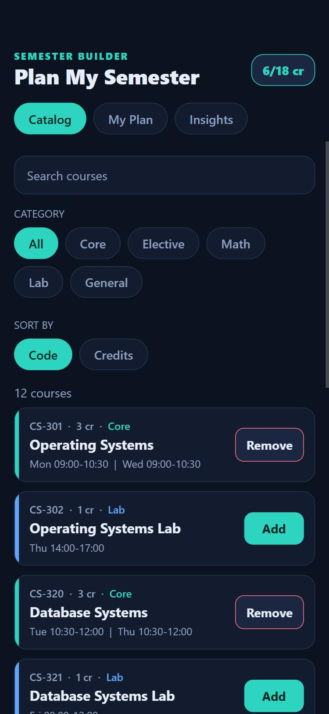
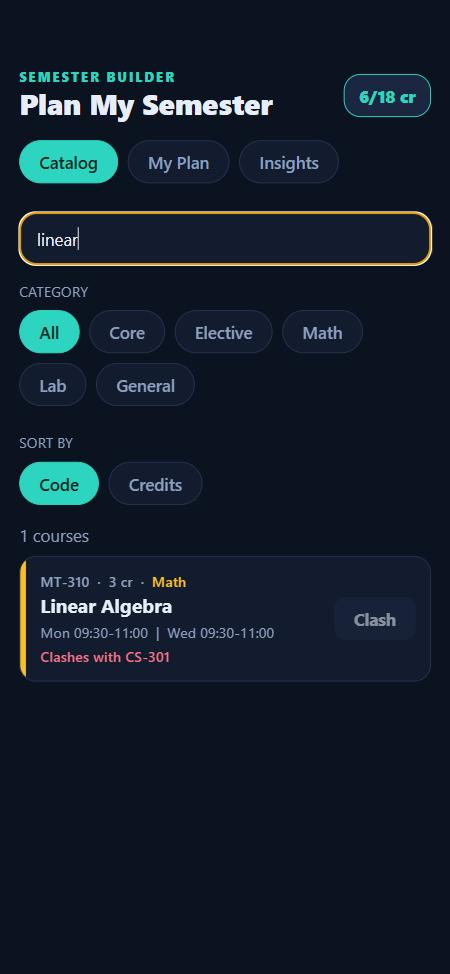
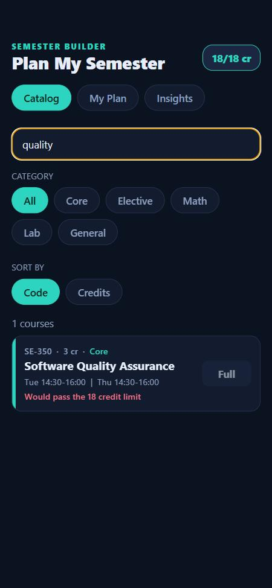
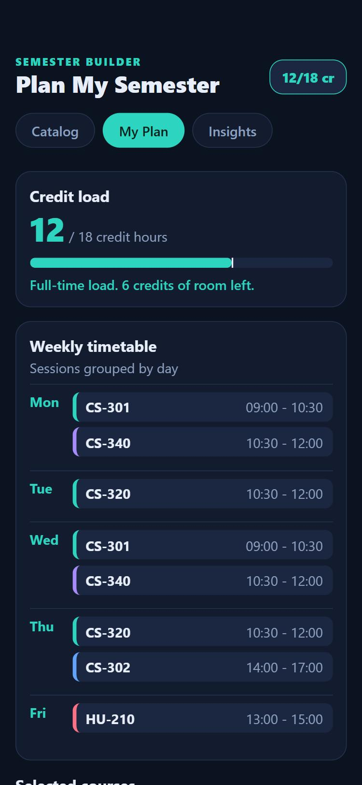
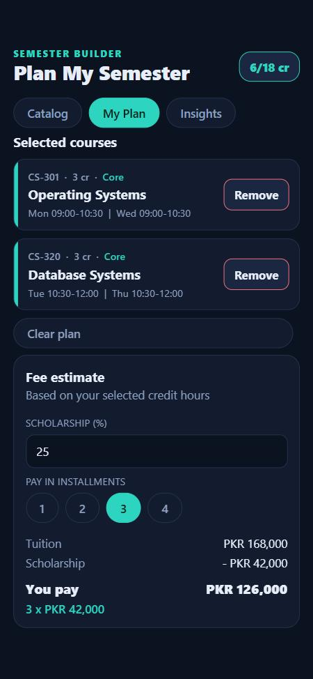
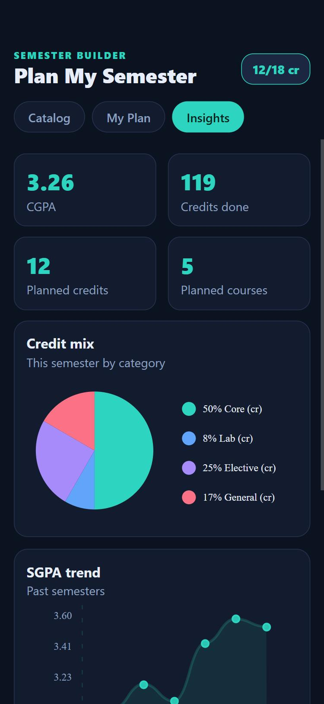
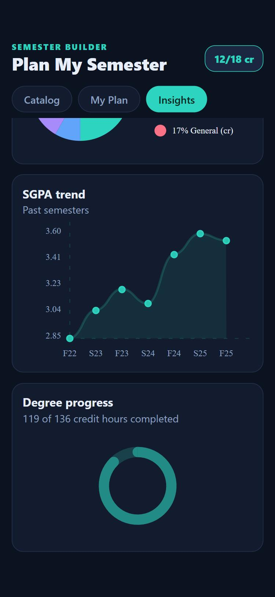

# Plan My Semester - Course Registration Planner

Software for Mobile Devices, Assignment 1. React Native (Expo), JavaScript.

Author: Abdullah Tariq (23I-3011)

## The problem

Choosing courses each semester is guesswork on a student portal. A student has to check by hand whether two courses overlap, whether the credit load is allowed, and what the fee will be, and only finds mistakes after registering.

Plan My Semester lets a student build a timetable before registering and tells them straight away:

- Does this course clash with something I already picked?
- Will adding it break the 18 credit hour limit, and am I still below the 12 credit full-time minimum?
- What does my week look like?
- How much will I pay after a scholarship, and how much per installment?

## Features

**Catalog**
- 12 sample courses with category, credit hours and weekly sessions.
- Search, category filter and sort (by code or credits).
- Each course shows Add, Remove, Clash (with the course it clashes with) or Full (credit limit reached).
- A short message confirms every add and remove.

**My Plan**
- Credit meter with a full-time minimum marker and a message for each state.
- Weekly timetable grouped by day, sorted by time, with a colour per category.
- Selected courses list with remove buttons and a Clear plan action.
- Fee estimate: tuition per credit hour, scholarship percentage (validated 0 to 100) and 1 to 4 installments.

**Insights** (charts with `react-native-chart-kit`)
- Pie chart: credits by category for the current plan.
- Line chart: SGPA over past semesters.
- Progress chart: degree credits completed.
- Tiles: CGPA, credits done, planned credits, planned courses.

**States handled:** empty plan, no search results, clashing courses, credit limit, below full-time load, invalid or empty scholarship value.

## Screenshots

| Catalog | Clash | Credit limit | Timetable |
|---|---|---|---|
|  |  |  |  |

| Fee estimate | Insights | Charts |
|---|---|---|
|  |  |  |

## How it is organised

```
App.js                     state (tab, plan, fee, toast) and the tab pills
src/constants.js           credit limits, fee rate, days
src/data/catalog.js        courses, categories, past semester results (objects and arrays)
src/lib/schedule.js        clash detection, credit totals, timetable grouping, add rules
src/lib/fees.js            fee estimate and scholarship validation
src/lib/gpa.js             CGPA and completed credits
src/theme/palette.js       colours
src/ui/                    Pill, Card, CreditMeter, CourseRow, Notice, Toast
src/screens/               CatalogScreen, PlanScreen, InsightsScreen
```

Screens are switched with a `tab` state variable and conditional rendering, not a navigation library.

## The rules

In `src/constants.js`: `MAX_CREDITS = 18`, `MIN_CREDITS = 12`, `RATE_PER_CREDIT = 28000`. Two courses clash when they have a session on the same day whose times overlap (`sessionsOverlap` in `src/lib/schedule.js`). A course can be added only if it does not clash and the total stays within the credit limit (`addState`).

## Setup and run

Requirements: Node.js, and the Expo Go app on a phone (or a browser for the web preview).

```bash
npm install
npx expo start
```

Scan the QR code with Expo Go (phone and computer on the same Wi-Fi). For the browser preview, run `npx expo start --web`.

Dependencies beyond the Expo template: `react-native-chart-kit`, `react-native-svg` (needed by the charts), `react-dom` and `react-native-web` (browser preview only).

A Snack version is also available: https://snack.expo.dev/xU3XrA-RbkKfOvEG659bE

## Notes

- All data is sample data held in state. It resets when the app reloads.
- The fee rate, limits and course list are sample values, not real university figures.

- AI usage is documented in `docs/AI_Usage_Report_Abdullah_Tariq.docx`.
